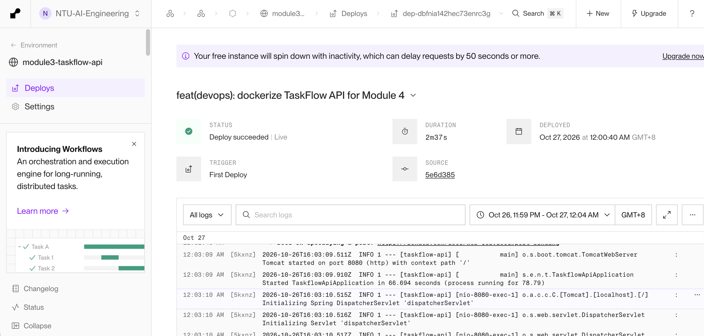
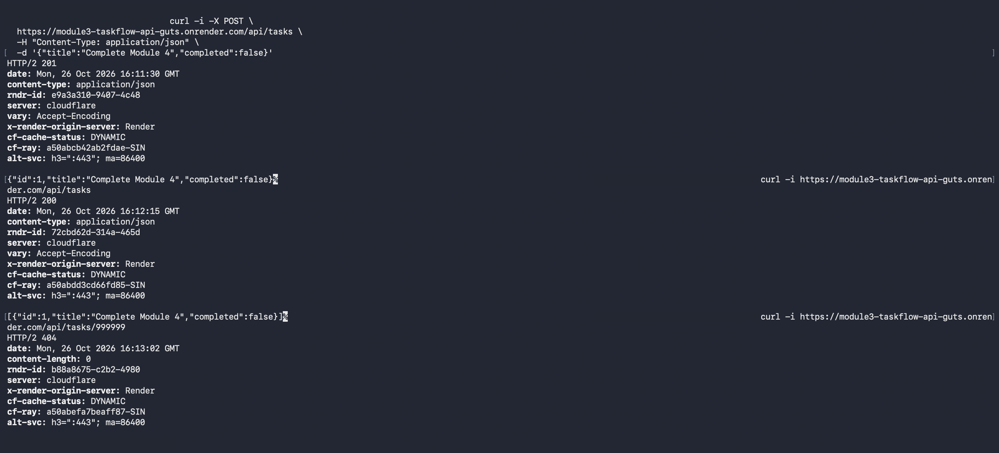
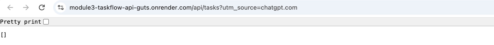
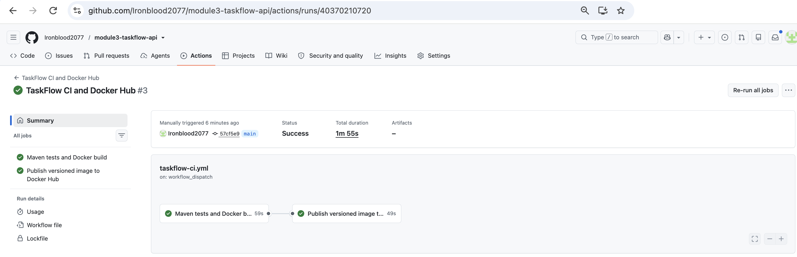
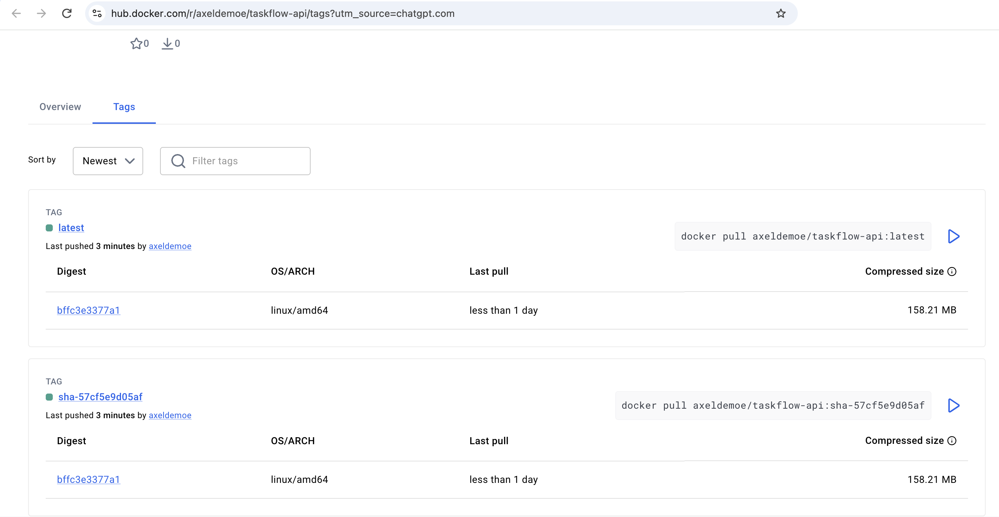

# TaskFlow - Task Management API

A simple Spring Boot REST API for managing tasks, built for the NTU SCTP
Module 3 mandatory assignment. Tasks are stored **in memory** (a `HashMap`) -
there is no database, so all data is lost when the application stops.

## Technology

- Java 21
- Spring Boot 4.1.1
- Maven (with the Maven wrapper, `./mvnw`)
- Spring Web
- Lombok
- Spring Boot DevTools
- Spring AI (OpenAI starter, BOM 2.0.0)

## Architecture

The application is split into layers, each with one job:

```text
HTTP Request
     ↓
TaskController      receives the request, returns a ResponseEntity + status code
     ↓
TaskService         the business logic (update rules, mark-complete, AI summary)
     ↓
TaskRepository      stores and retrieves data, generates IDs
     ↓
HashMap<Long, Task> the in-memory data store
```

- **Controller** - speaks HTTP only. Thin: read request → call service → pick status.
- **Service** - makes the decisions. Knows nothing about HTTP.
- **Repository** - stores data. Knows nothing about business rules.
- **Model (`Task`)** - a plain POJO carrying `id`, `title` and `completed`.

Each layer is wired to the next using **constructor injection**.

## Package structure

```text
src/main/java/sg/edu/ntu/taskflowapi/
├── controller/TaskController.java
├── model/Task.java
├── repository/TaskRepository.java
└── service/TaskService.java
```

## Endpoints

| Method | Endpoint                    | Purpose                        | Success |
|--------|-----------------------------|--------------------------------|---------|
| GET    | `/api/tasks`                | Get all tasks                  | 200 OK  |
| GET    | `/api/tasks/{id}`           | Get one task by id             | 200 OK  |
| POST   | `/api/tasks`                | Create a task (id is generated)| 201 Created |
| PUT    | `/api/tasks/{id}`           | Update a task                  | 200 OK  |
| DELETE | `/api/tasks/{id}`           | Delete a task                  | 200 OK  |
| PUT    | `/api/tasks/{id}/complete`  | Mark a task as completed       | 200 OK  |
| GET    | `/api/tasks/summary`        | AI-generated summary of tasks  | 200 OK  |

A request for an id that does not exist returns **404 Not Found** instead of
crashing.

### Example - create a task

```bash
curl -X POST http://localhost:8080/api/tasks \
  -H "Content-Type: application/json" \
  -d '{"title":"Study Spring Boot","completed":false}'
```

```json
{ "id": 1, "title": "Study Spring Boot", "completed": false }
```

The repository generates the `id`. Any `id` sent in the request body is ignored.

## Running

```bash
./mvnw spring-boot:run
```

The API is then available at `http://localhost:8080/api/tasks`.

To run the tests:

```bash
./mvnw test
```

## API key

`/api/tasks/summary` calls OpenAI through Spring AI. The API key is **not**
stored in this project. It is read from an environment variable named:

```text
OPENAI_API_KEY
```

Set it in your shell before starting the application:

```bash
export OPENAI_API_KEY=your-key-here
```

`application.properties` only references the variable (`${OPENAI_API_KEY}`) -
the real key never appears in any file in this repository.

The other six endpoints do not use AI and work without the key being set.

---

## Module 4 - Dockerization and Deployment

### Live deployment

**Live API:** <https://module3-taskflow-api-guts.onrender.com/api/tasks>

The assignment brief specifies Railway. The trainer approved **Render** as an
alternative platform, so the service is hosted on Render instead. The same
`Dockerfile` is used unchanged; no Render-specific code was added.

| Setting        | Value                                     |
|----------------|-------------------------------------------|
| Platform       | Render (trainer-approved Railway alternative) |
| Workspace      | NTU-AI-Engineering                        |
| Service        | `module3-taskflow-api` (Web Service)      |
| Source         | This GitHub repository, branch `main`     |
| Deployed commit| `5e6d385` - *feat(devops): dockerize TaskFlow API for Module 4* |
| Builder        | Root `Dockerfile`                         |
| Port           | `PORT=8080` (Tomcat listens on 8080)      |
| Region         | Singapore                                 |
| Instance type  | Free                                      |
| Environment variables | `PORT` only - **no `OPENAI_API_KEY`** |

### Dockerfile

A two-stage build keeps the final image small:

1. **Build stage** - `maven:3.9-eclipse-temurin-21` runs
   `mvn clean package -DskipTests` to produce the Spring Boot jar.
2. **Runtime stage** - `eclipse-temurin:21-jre-alpine` (JRE only, no Maven,
   no JDK, no source code) copies the jar in as `app.jar`, exposes port 8080
   and starts it with `java -jar app.jar`.

`.dockerignore` keeps `.git`, `target/`, any `.env` files and editor files
out of the build context, so local secrets can never be copied into an image.

### Build and run locally

```bash
# Run the tests first (the Docker build skips them)
./mvnw test

# Build the image
docker build -t taskflow:latest .

# Run it - no API key needed for the six CRUD endpoints
docker run --rm -p 8080:8080 taskflow:latest

# Optional: enable the AI summary endpoint with your own key
docker run --rm -p 8080:8080 -e OPENAI_API_KEY="$OPENAI_API_KEY" taskflow:latest
```

The API is then available at `http://localhost:8080/api/tasks`.

### Test results

**Local (executed on the developer machine, Docker 29.8.1, Java 21):**

| Check | Result |
|-------|--------|
| `./mvnw clean test` | 1 test, 0 failures, 0 errors |
| `docker build -t taskflow:latest .` | Success |
| `GET /api/tasks` (fresh container) | `200`, `application/json`, `[]` |
| `POST /api/tasks` | `201`, task created with id `1` |
| `GET /api/tasks` after POST | `200`, created task returned |
| `GET /api/tasks/99` | `404` |
| `docker restart` then `GET /api/tasks` | `200`, `[]` - data lost, as expected |
| `docker stop` | Graceful Tomcat shutdown |

**Hosted on Render (captured in the screenshots below - cropped and with
personal details such as the shell prompt/hostname removed; the URLs, status
codes, response headers and JSON bodies are unaltered):**

| Check | Result |
|-------|--------|
| Render deploy status | *Deploy succeeded - Live*, source `5e6d385` |
| `GET /api/tasks` (before any POST) | `200`, `[]` |
| `POST /api/tasks` `{"title":"Complete Module 4","completed":false}` | `201`, `application/json`, id `1` |
| `GET /api/tasks` after POST | `200`, `application/json`, created task returned |
| `GET /api/tasks/999999` | `404` |

#### Render deployment



#### Live API - POST, GET and 404



#### Live API - GET in the browser



### Known limitations

- **No persistence.** Tasks live in an in-memory `HashMap`. Every restart,
  redeploy or free-tier spin-down wipes all data and ids restart at `1`.
- **Cold starts.** Render's free instance spins down after a period of
  inactivity. The first request afterwards can take **50 seconds or more**
  while the container restarts; later requests are fast.
- **AI summary is not operational in the deployment.** `GET /api/tasks/summary`
  needs an OpenAI key. No real key is deployed - `OPENAI_API_KEY` is not set
  on Render and is not stored in this repository or the Docker image. In the
  local Docker test, with at least one task stored and no key set, the endpoint
  returned `500` because OpenAI rejected the request. This was **observed
  locally only** - the summary endpoint was deliberately not called on Render.
  With no tasks it returns a fixed message without calling OpenAI.

### Continuous integration - GitHub Actions and Docker Hub

The workflow [`.github/workflows/taskflow-ci.yml`](.github/workflows/taskflow-ci.yml)
automates testing, building and publishing. Full setup notes are in
[`docs/module4-ci-setup.md`](docs/module4-ci-setup.md).

| Job | Runs on | What it does |
|-----|---------|--------------|
| **Maven tests and Docker build** | Every pull request to `main`, every push to `main`, manual runs | Sets up Java 21, runs `./mvnw clean verify` (the real test suite), then builds the multi-stage `Dockerfile` |
| **Publish versioned image to Docker Hub** | Pushes and manual runs on `main` only, after the first job passes | Logs in to Docker Hub and pushes `latest` plus an immutable `sha-<commit>` tag |

Security notes:

- The workflow token is limited to `contents: read`.
- Third-party actions are pinned to full commit SHAs.
- Pull requests never receive Docker Hub credentials and never publish.
- The Docker Hub access token is stored as the `DOCKERHUB_TOKEN` repository
  secret and passed to `docker login` via stdin, so it never appears in logs.
- The workflow does **not** deploy to Render; the live Render service above
  is unchanged.

**Evidence:**

| Item | Value |
|------|-------|
| Pull request | [#1 - add GitHub Actions workflow](https://github.com/Ironblood2077/module3-taskflow-api/pull/1) (merged) |
| Successful run | [TaskFlow CI and Docker Hub #3](https://github.com/Ironblood2077/module3-taskflow-api/actions/runs/40370210720) - both jobs succeeded on `main` @ `57cf5e9` |
| Docker Hub repository | <https://hub.docker.com/r/axeldemoe/taskflow-api/tags> |
| Published tags | `axeldemoe/taskflow-api:latest`, `axeldemoe/taskflow-api:sha-57cf5e9d05af` |
| Image | `linux/amd64`, both tags share digest `sha256:bffc3e3377a1...` |

Pull the published image and run it:

```bash
docker pull axeldemoe/taskflow-api:latest
docker run --rm -p 8080:8080 axeldemoe/taskflow-api:latest
```

#### GitHub Actions run #3



#### Docker Hub tags



Screenshots are cropped to remove browser tabs and profile details; URLs,
statuses, tags and digests are unaltered.

### Stretch goals

- [x] **Stretch Goal 1 - GitHub Actions CI with Docker Hub publishing** (see above)
- [ ] **Stretch Goal 5 - Security Checks / Dependency Scanning** (not implemented)
